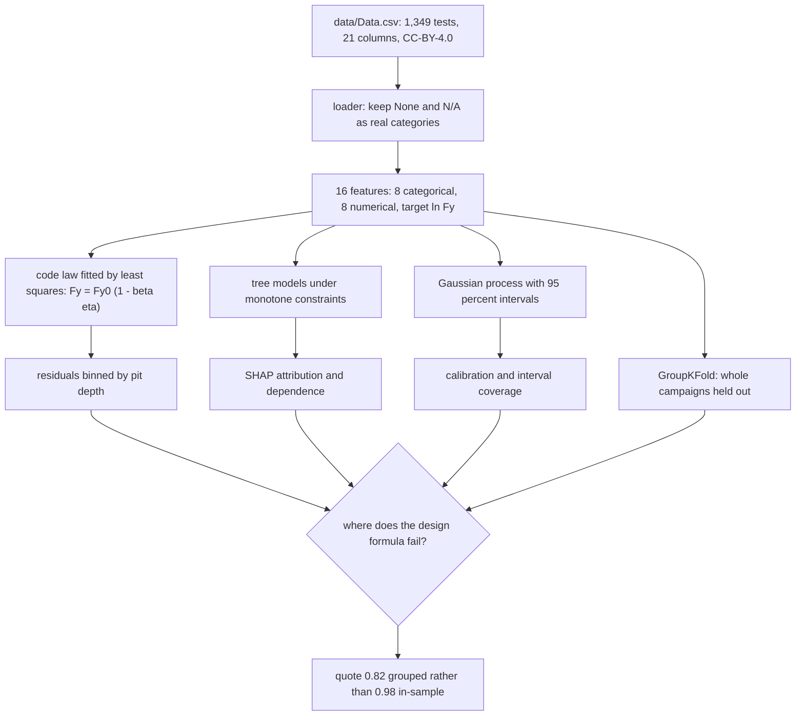

# Corroded steel bar yield force analysis: pitting-notch effects against uniform mass loss

Predicting the residual yield force of corroded steel bars from 1,349 tensile tests across 26 published
campaigns, with the pitting notch effect separated from uniform thinning three ways.

[](https://colab.research.google.com/github/daniswaramp/steel-rebar-corrosion-strength/blob/main/notebooks/corroded_steel_ML.ipynb)

## What this adds

The source study built the database and compared machine-learning models across nine mechanical properties of
corroded bars. It did not interrogate the design formula an assessor actually reaches for, which is a straight
line in mass loss. This does that, and reports where the formula fails rather than how well a model scores.

- A properly fitted code law reaches R2 0.892 with a degradation factor of 1.602, where a pure area-loss
  reading implies 1.0. The formula is absorbing damage it has no term for.
- Its error grows with pit depth, from a mean residual of -0.127 in the shallowest bin to +0.389 in the
  deepest, so it overstates sound bars and understates the most pitted ones.
- Deleting the five pit-depth features costs 0.0012 of R2 in a score averaged over every row. Holding mass
  loss fixed and moving only depth drops the prediction by 0.142 in log units between no pit and 1.52 mm.
- Holding whole campaigns out drops R2 from 0.981 to 0.820 and multiplies MAPE by five, so 0.820 is the
  number to quote outside this file.

## The route



Fitting the formula and watching its residuals answers the question directly. Modelling the same data without
the formula and asking SHAP what the pit-depth family is worth answers it by subtraction. Holding whole
campaigns out answers how much of the result survives a new source.

## Data and attribution

The database belongs to Benjamin Matthews, Alessandro Palermo and Allan Scott: *Monotonic Tensile Testing of
Corroded Reinforcing Steel Bars Database*, Zenodo, 2023, doi
[10.5281/zenodo.8035720](https://doi.org/10.5281/zenodo.8035720), released under CC-BY-4.0. The copy used
here, and the model comparison it shipped with, comes from
[bma114/corroded-steel-machine-learning](https://github.com/bma114/corroded-steel-machine-learning). The
published article is Matthews, Palermo, Logan and Scott, *Construction and Building Materials* 438, 2024, doi
[10.1016/j.conbuildmat.2024.137023](https://doi.org/10.1016/j.conbuildmat.2024.137023).

Data.csv is redistributed under CC-BY-4.0 with the attribution above. The file is byte-identical to the copy
in that repository and no column was altered. Everything beyond it, which is `src/pipeline.py`, the notebook,
the figures and the results file, is mine, under the MIT licence in LICENSE.

8 categoricals (specimen type, load history, bar type, steel origin, grade, corrosion method, cathode,
cleaning) and 8 numericals (diameter, gauge length, current density, exposure, solution concentration, mass
loss, corroded length, penetration depth), against ln(Fy) from 2.8 to 417 kN.

## Results (held-out fifth, fixed seeds)

| Model | R2 | MAPE (kN) |
|---|---|---|
| Code law Fy0(1-beta eta), beta = 1.60 | 0.892 | 22.1% |
| XGBoost (monotone-constrained) | 0.981 | 7.5% |
| GPR (PICP95 0.959) | 0.981 | 7.7% |
| LightGBM / RF | 0.979 / 0.978 | 8.3 / 8.8% |
| XGB without pit-depth family | 0.980 | 7.6% |
| XGB, grouped by campaign (unseen) | 0.820 | 37.8% |

Ten-fold CV ranks the same way: XGB 0.990, GPR 0.989, LightGBM 0.987, RF 0.986, MLP 0.971, MLR 0.964.

## Figures


Three panels, which is the whole comparison in one image. XGBoost and the Gaussian process both reach R2
0.981 against 0.892 for the fitted code law. The formula is good enough in the middle of the range and
visibly worse at the ends, and the ends are where an assessor needs it.


Three conditional curves, one per mass loss level of 2, 8 and 20 per cent. Mass loss is held fixed inside each
curve and only penetration depth moves, so the fall is what the formula cannot see. The drop starts earlier at
low mass loss, where the pit is a larger share of what is left.


Attribution run on the held-out rows. The pit-depth family is the part of the input the design formula cannot
see, and deleting those five features costs 0.0012 of R2. The interval calibration is in
`figures/calibration.png`: the 95 per cent bands cover 95.9 per cent of held-out rows, which is what lets the
grouped-campaign result carry an honest range.

## Equations

The design formula as an assessor writes it, with the degradation factor fitted rather than assumed and the
target in logs so the fit is a single least-squares pass:

$$F_y = F_{y0}\left(1 - \beta\,\eta\right), \qquad \ln F_y = \ln F_{y0} + \ln\left(1 - \beta\,\eta\right)$$

$F_y$ is the residual yield force of the corroded bar in kN, $F_{y0}$ the yield force of the uncorroded bar,
which is the fitted intercept, $\eta$ the mass-loss ratio as a fraction (0.1 is ten per cent), and $\beta$ the
degradation factor, fitted at 1.602 where pure area loss would put it at 1.0.

Scoring, on the held-out fifth and again under campaign grouping:

$$R^2 = 1 - \frac{\sum_i (y_i - \hat{y}_i)^2}{\sum_i (y_i - \bar{y})^2}, \qquad
\mathrm{MAPE} = \frac{100}{n}\sum_i \left|\frac{y_i - \hat{y}_i}{y_i}\right|$$

$y_i$ is a measured $\ln F_y$ and $\hat{y}_i$ its prediction, $\bar{y}$ the mean of the measurements and $n$
the number of held-out bars. Both are reported twice because a model can score well on unseen bars from
campaigns it has already seen.

Interval coverage, the share of held-out rows inside the predicted 95 per cent band:

$$\mathrm{PICP} = \frac{1}{n}\sum_i \mathbb{1}\left[\,l_i \leq y_i \leq u_i\,\right]$$

$l_i$ and $u_i$ are the lower and upper bounds the Gaussian process predicts for bar $i$. A 95 per cent band
should cover about 95 per cent of rows and this one covers 95.9, which is what makes the interval worth
quoting.

Attribution, which is where the second result comes from:

$$\phi_j = \sum_{S \subseteq N \setminus \{j\}} \frac{|S|!\,(|N| - |S| - 1)!}{|N|!}
\left[f(S \cup \{j\}) - f(S)\right], \qquad f(x) = \mathbb{E}[f(X)] + \sum_j \phi_j(x)$$

Shapley values of the model treated as a cooperative game: $N$ the features, $S$ a subset of them not
containing feature $j$, $f(S)$ the model output with the features outside $S$ averaged over, so the bracket is
what adding feature $j$ to that subset changes. The second expression is the point of using them, since the
attributions add back up to the prediction with no residual.

$$\frac{\partial f}{\partial x_j} \geq 0 \quad \text{for the features where increasing the value can only
increase the yield force}$$

$f$ is the fitted model and $x_j$ one input feature. The constraint holds the sign on mass loss and
penetration depth, which can only take strength away, and stops the ensemble from producing a response that
dips and recovers inside the range of the data.

## Methods and tools

- numpy and pandas for the loader and the feature assembly. It treats `None` and `N/A` as real categories,
  because pandas reads them as missing and that silently drops rows.
- scikit-learn for the Gaussian process, the random forest, the multilayer perceptron and the linear baseline,
  and for `GroupKFold`, which keeps whole campaigns on one side of the split. ARD-GPR was tried and cut at
  over seven minutes per fit, so the isotropic kernel keeps the intervals cheap.
- XGBoost and LightGBM for the boosted trees, with monotone constraints on the features whose direction is
  known and fixed seeds so the table is reproducible.
- SHAP for the attribution and the dependence plots, run on the held-out rows rather than the training rows.
- The pipeline runs headless, about five minutes, and writes `results/results.json` plus every figure to
  `figures/`, so the numbers in this README can be regenerated rather than trusted.

### Why a re-run may differ in the last digit

The table comes from the run stored in the notebook, on numpy 2.4.6, pandas 3.0.5, xgboost 3.2.0, lightgbm
4.7.0 and shap 0.51.0. On Kaggle's versions the degradation factor of 1.602 and the coverage of 0.959 came out
identical, XGBoost's held-out R2 landed at 0.983 instead of 0.981 and the grouped R2 at 0.788 instead of
0.820. Quote the grouped figure as 0.79 to 0.82 and pin the versions if you need to match the table exactly.

## Layout

```
data/Data.csv                       the 1,349-test database, 21 columns
src/pipeline.py                     CV, model fits and figures, headless, about five minutes
notebooks/corroded_steel_ML.ipynb   the write-up, 60 cells, outputs stored
figures/                            parity, notch residuals, partial dependence, SHAP, calibration
results/results.json                the numbers the notebook quotes
requirements.txt
```

## Run it

The badge opens the notebook in Colab, where the first cell clones this repository, changes into it and
installs anything the image lacks. Locally:

```bash
python -m venv .venv
.venv/Scripts/pip install -r requirements.txt
.venv/Scripts/python src/pipeline.py
.venv/Scripts/jupyter notebook notebooks/corroded_steel_ML.ipynb
```

## Notes

Depth is one number per bar, the deepest point, not pit geometry. Pit count, spacing and shape are absent from
this database, which is why the notebook states what it cannot tell.
